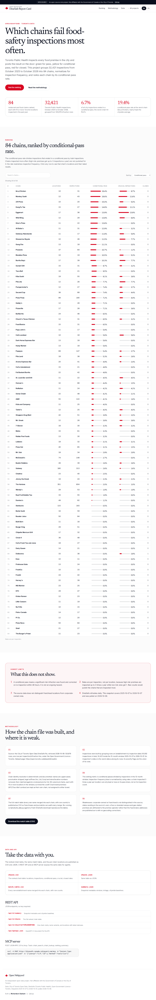
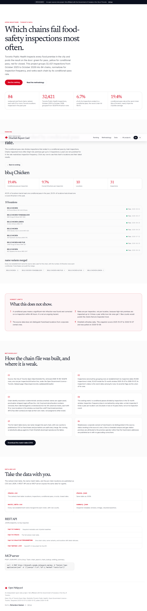

# DineSafe Report Card

Which restaurant chains fail food-safety inspections most often.

**Live:** https://dinesafe.canada.nshipyard.com (deploy handled by the Open Nshipyard coordinator)

An [Open Nshipyard](https://canada.nshipyard.com) project. Toronto Public Health inspects every food premise in the city and posts the result on the door: green for pass, yellow for conditional pass, red for closed. This project groups 32,421 inspections (October 2025 to October 2026) into 84 chains, normalizes for inspection frequency, and ranks each chain by its conditional-pass rate.

## Screenshots





## Headline figures

- 84 restaurant and food chains ranked, each with 10 or more Toronto locations inspected in the past year.
- 32,421 Toronto Public Health inspections, October 2025 to October 2026, grouped from 120,879 infraction rows.
- Citywide conditional-pass rate: 6.7%. Worst chain (bb.q Chicken): 19.4%, nearly triple the citywide average.
- Rates are per inspection, not per location: high-risk premises are inspected up to 3 times a year, so raw counts would punish the chains that are inspected most.

## What this does not show

- A conditional pass means a significant-risk infraction was found and corrected on re-inspection within 48 hours. It is not an ongoing hazard.
- The source data does not distinguish franchised locations from corporate-owned ones.
- DineSafe refreshes daily. This snapshot covers 2025-10-07 to 2026-10-07 and was pulled on 2026-10-09.

## Data sources

- City of Toronto Open Data: DineSafe. Dataset page: https://open.toronto.ca/dataset/dinesafe/
- Licence: Open Government Licence - Toronto.

## Methodology

1. The DineSafe CSV was retrieved 2026-10-09 (120,879 rows, one row per inspection/infraction line).
2. Inspections were built by grouping rows on (establishment id, inspection date): 81,002 inspections total, 32,421 in the 12-month window. An inspection's status is the worst status among its rows.
3. Chain identity resolution is deterministic: names are uppercased, punctuation stripped, legal suffixes (Inc, Ltd, Corp) and store/location numbers removed, then matched against a reviewed anchor list in `scripts/build_data.py`. Dual-brand premises (KFC/Taco Bell combos) are kept as their own chain.
4. The ranking metric is conditional passes divided by inspections in the window. Chains with fewer than 10 locations are excluded for stability.
5. The full match table (every raw name merged into each chain, with row counts) is published as `public/data/match_table.csv`.

Reproduce: `python3 scripts/build_data.py /path/to/dinesafe.csv /tmp/out` then copy the JSON into `data/` and the CSVs into `public/data/`.

## API

- `GET /api/v1/summary` - snapshot metadata and citywide baselines
- `GET /api/v1/chains` - the full ranked chain table
- `GET /api/v1/chain?id=TIM%20HORTONS` - one chain: stats, name variants, locations with latest statuses
- `GET /api/openapi.json` - OpenAPI 3.1 document
- `POST /mcp` - MCP server (JSON-RPC 2.0): tools `chain_search`, `chain_lookup`, `ranking_summary`

## Development

```bash
npm install
npm run build
npm start
```

## Author

Built by [Richardson Dackam](https://x.com/richardsondx) ([GitHub](https://github.com/richardsondx)). Not affiliated with the Government of Canada or the City of Toronto.
